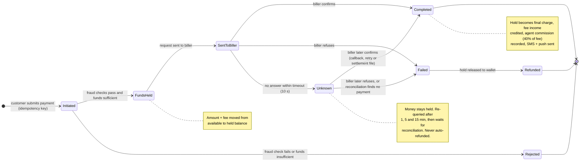

# Payment State Diagram

Source: brief section 2.5 (Payment life cycle). Only the transitions below are allowed (FR-11).

## Transition table

| From | Event | To |
|---|---|---|
| Initiated | Fraud checks pass and wallet has enough funds | FundsHeld |
| Initiated | Fraud check fails or funds are insufficient | Rejected |
| FundsHeld | Request sent to biller | SentToBiller |
| SentToBiller | Biller confirms | Completed |
| SentToBiller | Biller refuses | Failed |
| SentToBiller | No answer within the timeout | Unknown |
| Unknown | Biller later confirms (callback, retry or settlement file) | Completed |
| Unknown | Biller later refuses, or reconciliation finds no payment | Failed |
| Failed | Hold released to the wallet | Refunded |

Final states: **Completed**, **Rejected**, **Refunded**. Any event not in this table is rejected by the State pattern implementation (e.g. a duplicate TopUpNet "success" callback on a Completed payment is ignored and logged — hard case 6).
